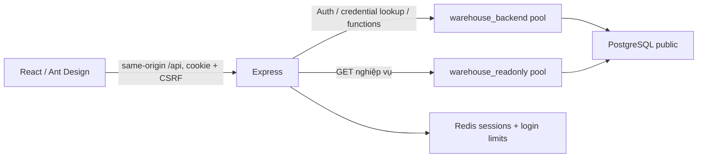

# Supabase integration — repository audit

Ngày: 05/11/2026. Baseline: `dd022569c9ad62a499a5ea9df80e9ffb8f37222c`, branch `feature/supabase-integration`, working tree sạch trước thay đổi. **VERIFIED** ở đây chỉ có nghĩa đã đọc source hoặc đã chạy kiểm tra offline được nêu rõ; không có kết nối Cloud/main.

## 1. Phạm vi và nguồn thực tế

Yêu cầu mới cho phép chuẩn bị code/SQL nhưng yêu cầu thiết kế Authentication được chấp thuận trước tích hợp, và cấm tự kết nối/thay đổi database. [Thiết kế đề xuất](SUPABASE_TARGET_ARCHITECTURE.md) và [trạng thái bàn giao](SUPABASE_IMPLEMENTATION_STATUS.md) phân biệt phần đã làm với phần chờ duyệt.

Các entry có thật: `src/server.js`, `src/app.js`, `src/config/{env,secure}.js`, `src/db/{pool,secure-access,redis}.js`; Auth nằm trực tiếp trong `src/auth/index.js`, không có cây controllers/services Auth riêng. RBAC là `createAuth().requireRoles` cùng principal guards tại routes, không có file middleware RBAC riêng. Frontend E2E ở `frontend/tests/e2e/warehouse.spec.ts`, không phải `frontend/e2e/`.

Đã đối chiếu `package.json`, frontend package/config, server/app/config/pool/preflight, Auth/session/password, toàn bộ route và repository nghiệp vụ, typed client/OpenAPI, AuthProvider/login/users/protected routes, launcher/dev/E2E guards và các test liên quan. SQL phase3/admin, `BACKEND_READINESS.md`, `PHASE3_SECURITY_REVIEW.md` không đổi so với lượt review trước; tiếp tục dùng inventory 14 SQL/psql và schema/ACL đã ghi tại [migration plan](SUPABASE_MIGRATION_PLAN.md). `FRONTEND_READINESS.md` là bằng chứng lịch sử; các lần chạy mới được ghi riêng.

Không đọc `.env` hoặc thư mục secret local để tìm Cloud credential; unit tests chạy với `APP_ENV_FILE` trỏ tới đường dẫn không tồn tại để module config không tự load `.env` chính.

## 2. Kiến trúc hiện tại — VERIFIED từ source

- `server.js` tạo hai `pg.Pool`, chạy exact security preflight, kết nối Redis, tạo Auth rồi mới listen loopback. Shutdown drain HTTP trước đóng resources.
- `env.js` tự load `.env` gốc khi không có `APP_ENV_FILE`; hai pool dùng chung host/port/database. Reader default read-only; writer default read-write.
- `app.js` giữ health public, JSON 16 KiB, Auth router trước authenticate, sau đó mount dashboard/stock/admin/read routes. Mọi response API no-store; không có CORS middleware hay trust proxy được bật.
- Login dùng username + Argon2id trong `public.users`, trả identity và opaque HttpOnly/SameSite cookie. Phiên giữ idle 30 phút/absolute 8 giờ; mỗi protected request đọc lại users/auth_version.
- Admin routes hash password trước gọi `admin_dashboard_write`; Redis revoke lỗi sau COMMIT được bỏ qua có chủ ý vì counter DB vẫn làm phiên cũ mất hiệu lực. Không được tái dùng giả định này cho một Auth provider HTTP call có thể thất bại.
- Stock repository nhận actor từ principal, transaction READ COMMITTED, UUID/advisory lock/row lock, retry có giới hạn, unknown-COMMIT giữ UUID. SQL là nguồn bất biến kho; không viết lại bằng Supabase browser CRUD.
- UI dùng `WarehouseApi`, tự lấy CSRF cho mutation, `credentials: include`; AuthProvider restore bằng `/auth/me`. Users UI chưa có email, flow đổi mật khẩu riêng chưa tồn tại.
- `/stock-movement` là placeholder của An; hai E2E của form được skip có lý do. Giữ nguyên phân công và UI.

## 3. Kiểm kê Redis đầy đủ

| Trách nhiệm | Source / state | Phương án Cloud đề xuất, chưa kích hoạt |
| --- | --- | --- |
| Opaque session | `sessions.js`: key hash token `ssw:p3:session:*`, user ID, auth version, epoch | Supabase access/refresh tokens; app session gate ở PostgreSQL chỉ giữ metadata, không giữ refresh token |
| Idle/absolute expiry, clock rollback | Lua touch, TTL, issuedAt/lastSeen/expiresAt | Gate SQL atomic giữ giới hạn hiện tại nếu không có tính năng tương đương được xác minh ở provider |
| CSRF state | Random token trong mỗi session, timing-safe compare + Origin | Bearer-only business API; không nhận cookie auth ở Cloud, kiểm Origin cho browser mutations; review riêng trước đổi middleware |
| Login brute-force | Lua counters pair/account/IP: 5/20/100 lần trong 15 phút; clear pair/account khi login thành công | Supabase Auth limits/CAPTCHA cho endpoint Auth trực tiếp; Express distributed counters PostgreSQL cho phần API còn lại |
| Thu hồi phiên theo user | Epoch key, Lua increment, TTL | Counter/cutoff + session metadata dùng chung; không dựa refresh-token revoke để chặn mọi JWT ngay |
| Cleanup và outage | Redis namespace ACL; command failures → 503 fail closed | Bounded metadata cleanup; DB/Auth outage → 503, không fallback anonymous/cache role cũ |
| Health account test | Redis `warehouse_health` PING, không đọc session | Cloud health không yêu cầu Redis; giữ regression local |

Không phát hiện Redis cache inventory, message queue hoặc realtime nghiệp vụ trong source đã rà soát. Không có general Express API rate limiter hiện tại ngoài login limiter; không được mô tả như đã có. Dependency Redis vẫn cần cho `local-test`; chỉ loại khỏi dependency graph/runtime Cloud sau nghiệm thu Auth mới, không xóa module/test local.

Process-memory limiter chỉ là lớp phụ: bốn máy tạo bốn budget độc lập, restart xóa state và có thể bị né. Không dùng nó làm thay thế duy nhất cho counter chia sẻ. PostgreSQL limiter/gate mới cần SQL/ACL/test riêng; provider Auth rate limit không tự bảo vệ Express.

## 4. Database và xung đột bảo mật

Schema baseline: 6 bảng/37 cột, 2 identity sequences, 14 indexes gồm PK/UNIQUE, 2 business functions, helper/trigger inventory; chi tiết đầy đủ tại migration plan. `users.auth_version` và `stock_transactions.request_scan_code` phải giữ. Không thay bigint actor hoặc UUID lịch sử.

| Điểm | Thực tế source / tài liệu | Hệ quả |
| --- | --- | --- |
| G1 TEMP | Exact preflight cấm CREATE hoặc TEMP. Supabase mô tả PUBLIC có TEMP cần cho dịch vụ. | Profile Cloud cần policy riêng được giải trình và test; không revoke TEMP toàn DB. |
| G2 membership | Executor check cấm `member` hoặc `roleid` bất kể flags. Provider có ADMIN-only membership do `supabase_admin` grant. | Phân biệt control-plane admin với đường INHERIT/SET runtime; không nới toàn bộ membership check. |
| Owner lifecycle | postgres Supabase không superuser; owner transfer cần SET và schema CREATE tạm. | Phải có đường upgrade/containment sau lockdown. |
| Default privileges | Creator postgres có thể cấp dư các role Data API; ALTER OWNER không làm sạch ACL. | Sanitization theo creator/global/schema + explicit object/cột ACL, không quét managed schemas. |
| Pooler | Config yêu cầu literal PGUSER, session_user/current_user bare role. | Supavisor username `role.project-ref` cần tách transport username và expected SQL identity. |
| TLS | Pool hiện không có SSL object; pg có đọc PGSSLMODE của process. | Config Cloud cần CA và hostname verification rõ ràng cho cả hai pools. |
| Auth mapping | users bigint, history FK; chưa có auth UUID/email. | Additive mapping/provisioning; không auto-link theo email hoặc metadata client. |
| Managed Auth session | JWT không chứa snapshot `auth_version` của ứng dụng. | Đọc counter hiện tại đơn thuần không đủ loại JWT cũ; cần session/cutoff có nguồn tin cậy. |

Các mô tả G1/G2 là từ tài liệu nhà cung cấp và phân tích source; chưa truy vấn project thực tế. [Supabase PUBLIC privileges](https://supabase.com/kb/troubleshooting/custom-role-inherits-privileges-that-were-not-explicitly-granted-ddaa1c), [provider memberships](https://supabase.com/kb/troubleshooting/cant-revoke-a-role-membership-granted-by-supabase_admin-d08922).

Project ref/host do chủ dự án cung cấp: `offprveszircoaxyaxpf`, `db.offprveszircoaxyaxpf.supabase.co`, database `postgres`, port 5432, báo cáo trước là 17.11. Không phải kết quả kết nối của đợt này. Data API giữ disabled; Auth `/auth/v1` là dịch vụ xác thực riêng, không cần bật `/rest/v1`.

## 5. API impact matrix — toàn bộ 29 operations

Ký hiệu: **P** giữ business payload/response, đổi transport auth sang Bearer; **A** thay đổi Auth contract; **U** thay đổi provisioning/reset; **H** giữ health. Đây là thiết kế, **chưa thay OpenAPI/client hiện hành**.

| Method / route | Nhóm | Tác động dự kiến |
| --- | --- | --- |
| POST `/api/auth/login` | A | Cloud frontend login qua Auth SDK, endpoint Express nhận Bearer để xác nhận mapping và trả identity; bỏ username/password + cookie ở Cloud |
| POST `/api/auth/logout` | A | Bearer, revoke app session metadata rồi SDK signOut scope local; không dùng cookie/CSRF Redis |
| GET `/api/auth/me` | A | Identity response giữ; Bearer + mapping + session gate thay cookie |
| GET `/api/auth/csrf` | A | Cloud capability response nêu Bearer/không cookie CSRF; không trả token giả rồi bỏ verify |
| GET `/api/products` | P | Giữ filters/envelope |
| POST `/api/products` | P | Giữ ADMIN + trigger inventory |
| GET `/api/products/{id}` | P | Giữ detail/units |
| PATCH `/api/products/{id}` | P | Giữ base-unit safety |
| PATCH `/api/products/{id}/status` | P | Giữ status |
| POST `/api/products/{id}/units` | P | Giữ unit constraints |
| PATCH `/api/product-units/{id}` | P | Giữ rename/immutable factor |
| GET `/api/inventory` | P | Giữ bigint strings |
| GET `/api/inventory/{productId}` | P | Giữ thiếu inventory khác tồn 0 |
| GET `/api/inventory/low-stock` | P | Giữ threshold/filter |
| GET `/api/transactions` | P | Giữ projection lịch sử |
| POST `/api/transactions` | P | Giữ UUID/payload/status/error/retry, actor UUID→bigint từ Backend |
| GET `/api/transactions/{id}` | P | Giữ snapshots |
| GET `/api/scan-points` | P | Giữ list |
| POST `/api/scan-points` | P | Giữ ADMIN |
| PATCH `/api/scan-points/{id}` | P | Giữ status/name |
| GET `/api/users` | P | Giữ ADMIN, không đưa auth UUID/hash vào response mặc định |
| POST `/api/users` | U | Cần email và quy trình Auth + mapping; idempotent provisioning, không chỉ ghi PHC hash |
| PATCH `/api/users/{id}` | P | Payload profile/role giữ, thêm invalidation Cloud trong transaction |
| PATCH `/api/users/{id}/status` | P | Business status authoritative; Auth ban là bước bổ sung, không điều kiện để block nghiệp vụ |
| POST `/api/users/{id}/reset-password` | U | Auth Admin API + app gate/cutoff, xử lý partial failure; không chỉ đổi hash public.users |
| GET `/api/dashboard/summary` | P | Giữ totals riêng theo đơn vị |
| GET `/api/dashboard/stock-trends` | P | Giữ bounded UTC dates |
| GET `/api/dashboard/top-products` | P | Giữ quantity ranking yêu cầu baseUnit |
| GET `/api/health` | H | Giữ PostgreSQL check, không biến thành chứng nhận Auth provider hoạt động |

Tổng: **22 P + 4 A + 2 U + 1 H = 29** trên 24 path templates. Giữ số operation không đồng nghĩa giữ wire contract. Cloud OpenAPI cần Bearer security, auth schemas và user provisioning sửa đồng bộ typed client/Swagger/tests khi thiết kế được duyệt. Chưa có operation đổi mật khẩu self-service trong 29 API: nếu thêm Express orchestration cho thao tác này, phải công bố operation mới, không giấu trong con số 29.

## 6. Required migrations và trách nhiệm

- Schema baseline độc lập Cloud; không copy bootstrap DB/fixtures/guard local. SQL review artifacts không được chạy và phải có gate chặn thực thi.
- Mapping additive `auth_user_id` UNIQUE/FK giữ bigint; trạng thái provisioning/cutoff/session metadata/rate buckets và grants chỉ sau review thiết kế.
- Hai business functions giữ stock và catalog logic. Admin user.create/reset cần adapter/saga, không dùng nguyên nhánh hash cũ như Auth Cloud hoàn chỉnh.
- Cloud security policy cho TEMP/provider membership, scoped ACL/defaults, authentication helper owner và managed-session read access cần xác minh riêng.
- Safe seed là controlled provisioning của operator, không password mặc định, không seed ngầm ở dev launcher.

## 7. Baseline thực thi đợt này

| Check | Kết quả mới | Giới hạn |
| --- | --- | --- |
| Backend `npm test`, env-file vô hiệu | **VERIFIED 78/78 PASS** | Doubles/loopback HTTP; không DB/Redis thật |
| Frontend `npm --prefix frontend test` | **VERIFIED 5/5 PASS** | Invariants bigint/UUID/deadline |
| Frontend build gồm strict typecheck | **VERIFIED PASS** | Cảnh báo app/Swagger chunks >500 kB còn tồn tại |
| Backend real integration / frontend E2E | **NOT TESTED** | Có ghi fixtures; không chạy trong scope này |
| Supabase Auth/PG/Redis/Cloud network | **NOT TESTED** | Không kết nối |

Không có test bị xóa/deprecated/replaced trong đợt baseline này. Báo cáo 117 backend và 10 active E2E cũ chỉ là lịch sử, không cộng vào số mới.

## 8. Rủi ro và blockers

Chủ dự án đã duyệt hướng D1–D7 trong target architecture để tiếp tục code. **BLOCKED/NOT TESTED** còn lại: signing-key mode/issuer/audience thực tế chưa xác minh; session metadata access/grantor maintenance và password lifecycle chưa chứng minh; chưa có staging/credential/CA được cấp qua kênh an toàn; network IPv6/session pooler, provider Auth settings/SMTP/CAPTCHA/redirects chưa kiểm tra.

Không xóa Redis của local-test. Không cài Storage khi chưa có nhu cầu. Không thay UI của An. Hoàn thành code offline tách biệt không phải hoàn thành full Cloud integration. Công việc đang tạm dừng theo yêu cầu chủ dự án; xem checkpoint để tiếp tục.
