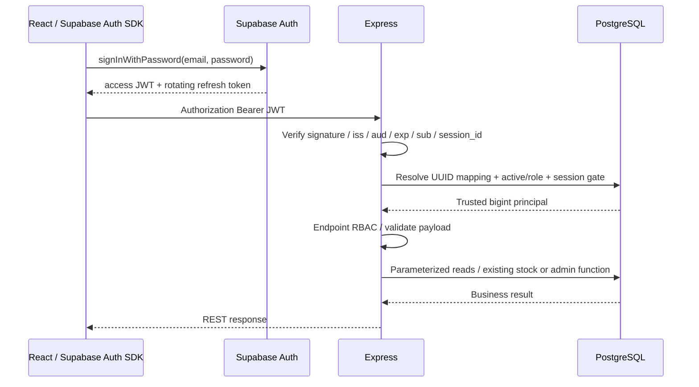

# Supabase target architecture — đề xuất để duyệt

Ngày: 05/11/2026. **Chủ dự án đã duyệt hướng D1–D7 trong cuộc trò chuyện để tiếp tục code.** Chi tiết provider/password lifecycle vẫn cần xác minh; phê duyệt không bao gồm kết nối, migration hoặc provision Cloud. [Audit](SUPABASE_ARCHITECTURE_AUDIT.md) là căn cứ source; [checkpoint](SUPABASE_IMPLEMENTATION_STATUS.md) ghi chính xác phần đã thực hiện và phần chưa làm.

**Cập nhật sau khi tiếp tục checkpoint:** D1–D7 đã được triển khai phần offline. Chủ dự án đã duyệt bổ sung [D8](../scripts/supabase/55-provider-contract.md): bridge chỉ đọc thời hạn phiên do postgres sở hữu trong schema warehouse_private, EXECUTE riêng cho auth executor. Source SQL/checker/negative tests đã có, chưa chạy database. Yêu cầu mới nhất tiếp tục **không kết nối Supabase**; runtime/migration giữ chốt chặn do password lifecycle và staging chưa xác minh. Những đoạn dưới về cấp quyền Auth trực tiếp được thay bằng D8, không coi mô tả mục tiêu là trạng thái Cloud đã triển khai.

## 1. Quyết định cần duyệt trước tích hợp

| ID | Đề xuất cụ thể | Lý do / phần còn phải chứng minh |
| --- | --- | --- |
| D1 | Cloud đăng nhập email + password bằng Supabase Auth SDK; username chỉ là tên nghiệp vụ. Không self-signup vào kho. | Provider không hỗ trợ password login bằng username như API hiện tại; provisioning cần email được operator/Admin cung cấp. |
| D2 | Bearer-only Express; SDK lưu session theo tab bằng custom `sessionStorage`, không localStorage mặc định. | Hỗ trợ reload/refresh, giảm lưu qua lần đóng browser; refresh token vẫn JS-readable, rủi ro XSS phải được chấp nhận và giảm thiểu. |
| D3 | Mapping UUID→bigint, kiểm active/role/session metadata ở DB mỗi protected request; giữ app idle 30m/absolute 8h bằng gate SQL. | Đọc auth_version hiện tại không tự chứng minh JWT cũ đã bị revoke. Cần nguồn session creation/revocation đáng tin cậy và transactional gate. |
| D4 | Profile Cloud cho phép riêng PUBLIC TEMP và inbound provider ADMIN membership không INHERIT/SET; giữ mọi kiểm tra nguy hiểm khác. | Đây là thay đổi policy có giới hạn, phải có negative tests, audit grantor/effective paths và staging proof. |
| D5 | Hai pg pools, direct hoặc Supavisor session-mode được cấu hình rõ, TLS CA/hostname bắt buộc; transaction pooler chưa hỗ trợ. | Tách connection username khỏi SQL identity; không dùng postgres runtime, không chấp nhận TLS no-verify. |
| D6 | Provider Auth protection + PostgreSQL distributed rate/session metadata; Redis giữ cho local-test, không chạy trong Cloud. | Memory limiter không đủ khi bốn Backend local cùng dùng Cloud. Cần đo tải/cleanup, fail closed khi DB outage. |
| D7 | Provision/reset qua Auth Admin API được cô lập phía server + DB saga có idempotency/reconciliation; thêm role NOLOGIN hẹp cho identity/session/rate helper nếu cần. | Provider HTTP và SQL không có distributed transaction; không hứa atomic toàn hệ thống. Quyền managed Auth session và self-password flow còn gate ở mục 5. |

Chấp thuận D1–D7 là chấp thuận thiết kế để tiếp tục code/review, **không** phê duyệt chạy SQL, tạo user thật, bật Data API hay cutover. Nếu không chấp thuận JS-readable refresh token ở D2, cần thiết kế BFF/HttpOnly cookie riêng, thay đổi flow frontend-direct-Auth và giữ CSRF; không lặng lẽ chuyển sang BFF.

## 2. Luồng mục tiêu

Frontend không dùng `.from()`/`.rpc()` để truy cập object nghiệp vụ. Auth SDK chỉ dùng `/auth/v1`; Data API `/rest/v1` vẫn disabled. Không Storage hoặc Realtime mới.

## 3. Xác minh JWT

Chỉ dùng Supabase SDK `getClaims`/`getUser` hoặc thư viện JWT chuẩn, không tự viết verify signature. Supabase hỗ trợ JWKS cho signing keys bất đối xứng; project dùng key đối xứng cần xác thực với Auth server thay vì giả định JWKS có key. [Supabase JWT](https://supabase.com/docs/guides/auth/jwts), [getClaims](https://supabase.com/docs/reference/javascript/auth-getclaims).

Mode thực tế **chưa biết**, không fetch JWKS project trong đợt này. Config phải khai báo mode/algorithm đã được xác minh ở bước được phép; không tự fallback từ asymmetric verification fail sang decode/HS256. Không nhận URL `jku`, `x5u`, issuer hoặc JWKS endpoint từ token/client.

Verifier dự kiến kiểm:

- Bearer header duy nhất, giới hạn độ dài, đúng cấu trúc, không nhận token qua query string/cookie.
- Signature hợp lệ với allowlist thuật toán/key type đã chốt; issuer chính xác `https://<project-ref>.supabase.co/auth/v1`, audience `authenticated`, expiry/nbf/iat theo policy clock skew hữu hạn; không chấp nhận token thiếu exp.
- `sub`, `session_id` là UUID hợp lệ; không anonymous identity hoặc API/service-role token thay human session. JWT role claim không quyết định vai trò ADMIN/KEEPER/STAFF/VIEWER.
- Key rotation/cache có giới hạn, timeout fetch, unknown kid làm refresh có giới hạn; provider/JWKS outage khi không có trusted key → 503, signature/claims sai → 401. Không biến mọi lỗi provider thành 401 hoặc fallback cached role vô thời hạn.
- Public key cache không phải cache mapping/role/status. Key revocation và logout không đồng nghĩa mọi JWT có sẵn mất hiệu lực ngay.

Không log Authorization, access/refresh token, provider errors nguyên bản, email/password hoặc connection config. Error handler hiện chỉ log event/code/type sẽ được tái sử dụng.

## 4. Mapping và provisioning

Giữ `public.users.user_id bigint` và mọi history FK/UUID. Đề xuất additive:

- `auth_user_id uuid NULL UNIQUE REFERENCES auth.users(id) ON DELETE NO ACTION`: nhiều legacy user chưa map được phép NULL, Auth UUID non-null không thể map hai users.
- `auth_state varchar(12) NOT NULL DEFAULT 'PENDING'`, CHECK `PENDING/READY/BLOCKED`; READY cần Auth UUID. Đây là trạng thái kỹ thuật, không thay `is_active` nghiệp vụ hoặc role.
- `auth_reauth_after timestamptz NOT NULL DEFAULT '-infinity'`: cutoff nguồn DB để từ chối session có trước lần forced reauthentication.
- Bảng phụ session admission/revocation, rate buckets và provisioning operation metadata theo scope bên dưới. Không lưu JWT/refresh token/plaintext password trong các bảng này.

FK chỉ tham chiếu PK `auth.users.id`, không email; không CASCADE xóa users/history khi xóa Auth account. Supabase có hướng dẫn liên kết application table với Auth PK; lựa chọn NO ACTION ở đây là quyết định bảo toàn kho, khác ví dụ profile có cascade. [Supabase user management](https://supabase.com/docs/guides/auth/managing-user-data).

Không trigger tự tạo ADMIN từ signup metadata, không tự gán ADMIN cho user đăng nhập đầu tiên, không tự liên kết theo email trùng. App metadata có thể hỗ trợ UX nhưng role authoritative luôn từ public.users. Cấu hình signup/Auth ngoài ứng dụng cần operator review; user Auth không mapping vẫn bị từ chối kho.

### Admin tạo người dùng

1. Xác thực ADMIN + shared limiter, validate request có email/username/profile/role; tạo operation ID và record PENDING trong DB dưới khóa chống tạo trùng. Email chỉ để giao tiếp provider, không làm identity key lâu dài.
2. Auth Admin client riêng, persistSession/autoRefresh tắt, gọi API tạo/invite account qua credential server đặc quyền; ordinary requests không dùng client này. Không đưa secret/service key vào frontend hoặc cấp business table grants cho service_role.
3. Khi có UUID provider, transaction liên kết đúng application record/operation, giữ FK/UNIQUE, rồi chuyển READY theo trạng thái mong muốn. Người dùng chỉ truy cập kho khi mapping READY và is_active.
4. Nếu provider timeout sau create, đánh dấu outcome unknown, không tự create lại hoặc tự bind account có cùng email. Operator reconciliation xác minh ownership/UUID/operation rồi retry bước còn thiếu. Không xóa tự động một Auth account có thể thuộc người khác.
5. Chưa hoàn tất thì không trả 201 như đã tạo xong; cần Cloud error/schema mới với operation identifier không chứa secrets. Bảng operation không lưu password để retry; invite flow có thể giảm nhu cầu xử lý plaintext nhưng cần SMTP được nghiệm thu.

Admin SDK create/update chỉ ở server, theo API chính thức. [createUser](https://supabase.com/docs/reference/javascript/auth-admin-createuser), [updateUserById](https://supabase.com/docs/reference/javascript/auth-admin-updateuserbyid). Provider capability/key type/SMTP chưa được kiểm tra.

### Khóa, đổi role và mở khóa

Transaction nghiệp vụ giữ last-active-ADMIN lock/guard, cập nhật `is_active`/role và auth_version như hiện có, đồng thời cập nhật cutoff bằng DB clock khi counter đổi. Session gate dùng trạng thái mới trên request kế tiếp; transaction đã qua kiểm có thể hoàn thành theo policy local hiện có.

Auth ban/revoke refresh là lớp bổ sung sau commit; lỗi provider không làm mất hiệu lực business block, cũng không biến kết quả DB đã commit thành một write có thể retry mù. Mở khóa không phục hồi session cũ: cần đăng nhập mới sau cutoff. Profile-only edit không vô hiệu hóa phiên.

## 5. Session invalidation, logout và password — gate bảo mật

JWT thường vẫn hợp lệ tới expiry sau signOut. Supabase mô tả kiểm `session_id` với `auth.sessions` để phát hiện phiên đã bị xóa; session timeout có thể được dọn trễ. Vì vậy app phải tự kiểm idle/absolute nếu muốn giữ chính xác giới hạn local. [Supabase sessions](https://supabase.com/docs/guides/auth/sessions), [signOut scopes](https://supabase.com/docs/guides/auth/signout).

Đề xuất bảng phụ `warehouse_auth_sessions`: `session_id` PK, application user_id FK, auth_version tại admission, issued_at từ nguồn provider tin cậy, last_seen, expires_at, revoked_at. Không lưu token. Resolve helper dự kiến:

1. Sau verify JWT, kiểm mapping/active/READY và `auth.sessions` đúng UUID user/session; lấy creation timestamp từ DB, không từ body hoặc JWT iat mới sau refresh.
2. Session creation phải sau cutoff. Với app-session đã có, snapshot auth_version phải khớp counter hiện hành; chưa có chỉ được admission từ provider session đủ mới. Điều này ngăn token cũ chưa từng gọi app tự admission lại sau role/password change.
3. Atomic touch với DB clock, chặn clock lùi, idle ≥30m, absolute ≥8h hoặc revoked. Refresh không gia hạn absolute, không đổi phiên cũ thành phiên mới qua iat mới.
4. Scope khóa/order phải được review để session touch không tạo deadlock với admin user mutation; đo tải vì mỗi protected request có DB work. DB mất kết nối → 503 fail closed, không phục hồi quyền từ metadata client.

**BLOCKED trước implementation:** cần chứng minh provider hỗ trợ grant SELECT đúng cột session metadata cho một NOLOGIN identity executor riêng, thông qua quản trị được cho phép. Không grant runtime toàn `auth.sessions`/`auth.users`, không đọc refresh_tokens, không sửa managed Auth tables. Nếu không được hỗ trợ, cần thiết kế khác được duyệt; không thay bằng “getSession/decode là đủ”.

Logout Cloud: revoke app session metadata trước, rồi Auth SDK `signOut({scope:'local'})`, xóa state/token tab và UI principal; request sau với JWT cũ bị app gate chặn. Đăng xuất mọi thiết bị là action riêng có chủ đích. Nếu mạng/provider/DB lỗi, UI phải phân biệt xóa local state với server revocation chưa được xác nhận; không hứa đã revoke toàn hệ thống.

### Password reset và đổi mật khẩu

Admin reset phải đặt app gate/cutoff chặn phiên cũ **trước** gọi Auth Admin password API; lưu operation state để xử lý partial failure, giữ counter/audit. Không trả thành công chỉ vì public.password_hash đổi. Password legacy được giữ nguyên nullable, không sao chép plaintext/hash sang provider bằng cách ghi trực tiếp auth.users.

Self-service password change/recovery là **quyết định chưa đóng**: ứng dụng hiện không có operation này. Cần flow Auth chính thức, recent authentication/recovery validation, và chứng minh mọi đường đổi password (kể cả gọi trực tiếp Auth ngoài UI) vô hiệu hóa app sessions đúng yêu cầu. Chỉ một callback frontend cập nhật cutoff là không đủ vì có thể bị bỏ qua. Có thể cần provider-supported event/hook hoặc orchestration có bảo đảm tương ứng; chưa chọn/viết trigger lên managed tables khi chưa được review. Đây là blocker riêng, không coi D1–D7 được duyệt là bằng chứng giải xong hành vi provider.

Không tự tạo JWT claim auth_version rồi tin giá trị do client sửa. Chỉ đọc role/counter live cũng không tự bảo đảm password-reset JWT cũ bị loại; acceptance phải test token thật trước/sau reset, refresh và khóa/mở khóa.

## 6. Database security compatibility

Giữ `checkSecureAccess` local nguyên semantics. Cloud dùng checker riêng sau khi D4 được duyệt; chưa có cờ `skip security checks` hoặc fallback bỏ preflight.

### G1 PUBLIC TEMP

Cho phép **duy nhất TEMP nhận từ PUBLIC** trong Cloud profile, không database CREATE, không direct TEMP grant mở rộng, không CREATE public cho runtime/executor. Tất cả table/column/sequence/function restrictions vẫn giữ; search_path exact pg_catalog/public/pg_temp với temp cuối, SQL schema-qualified. Không revoke PUBLIC CONNECT/TEMP/USAGE để ép chạy local policy.

Residual risk: compromised runtime vẫn có thể tiêu thụ tài nguyên TEMP/large objects và PUBLIC extension surfaces. Giảm bằng connection budget/role limits, timeouts, isolation, secret rotation/monitoring; các giới hạn cần provider permission phải được xác minh, không hứa temp_file_limit đã set. Audit pg_net và managed PUBLIC objects; nếu có đường lộ secret/ghi nguy hiểm không cô lập được thì giữ NO-GO, không blanket allow.

### G2 membership và bảo trì

Đề xuất allowlist inbound ADMIN-only cho đúng `postgres` với grantor `supabase_admin`, `inherit_option=false`, `set_option=false`; vẫn cấm executor là member của role khác, mọi runtime SET/INHERIT path tới executor, mọi inbound khác hoặc SET/INHERIT bật. Kiểm cả direct và transitive capabilities, attrs/owners và grants; không chỉ so tên membership.

Provider postgres/control plane là trusted administrator có thể cấp quyền về sau; ADMIN-only không phải miễn trừ cho runtime. Tạm cấp SET/CREATE để transfer/upgrade rồi thu hồi grant do operator kiểm soát, xác minh flags còn lại. Kiểm sau migration, lúc startup và định kỳ; drift làm fail closed. Staging phải chứng minh containment/restore chứ không chỉ SELECT catalog.

### ACL / owner / RLS

Giữ hai executor stock/admin NOLOGIN, table owner postgres, direct DML runtime cấm, stock function owner/path/ACL/signature nguyên, business functions không PUBLIC EXECUTE. Scoped creator defaults + explicit revoke Data API trên từng object/cột/sequence; không `GRANT ALL`, không managed schema reset. Cloud writer không còn cần SELECT password_hash sau khi Auth mới thay thế đầy đủ; local writer giữ quyền cũ.

Identity/session/rate cần thêm NOLOGIN owner tách khỏi stock, không được sửa tồn/lịch sử hay đọc credential. Mỗi helper mới phải có allowlist signature/owner/search_path/EXECUTE; không bỏ exact checks của hai business names.

RLS baseline off có thể giữ với Data API off + SQL ACL nếu security review chấp thuận; bảng phụ chỉ backend/executor có quyền, không policy cho browser. Không bật RLS tùy tiện hoặc dùng BYPASSRLS để dập lỗi; nếu quy định vận hành yêu cầu RLS cần thiết kế/test tương ứng trước deployment.

## 7. Profile, kết nối và DX

`local-test`: launcher hiện tại, PostgreSQL/Redis test độc lập, cookie/CSRF/Auth cũ, không đổi `.env` chính. `supabase-cloud`: env-file riêng bắt buộc, không tự load `.env` local, không Docker/migration/seed trong launcher, không dùng admin runtime.

Cloud config phải xác nhận project ref/expected ref, Supabase URL/issuer khớp, database postgres, schema public, direct host hoặc session-pooler được khai báo đúng, port 5432, TLS certificate/hostname verification. Session connection username `warehouse_*.project-ref` khác SQL identity `warehouse_*`; cả current_user/session_user vẫn phải đúng. Transaction pooler 6543 chưa được hỗ trợ. [Supabase PostgreSQL connections](https://supabase.com/docs/guides/database/connecting-to-postgres), [pg SSL](https://node-postgres.com/features/ssl).

Hai pool với budget nhỏ; mặc định đề xuất 3/pool = 6/instance, bốn máy là 24 trước admin/monitoring. Timeout stock không đổi; đo latency trước khi cân nhắc thay policy. Backend loopback + Vite same-origin proxy cho Shared Cloud; production HTTPS/reverse proxy là bước triển khai riêng.

Root install cần cài dependencies frontend có lockfile, không hoist workspace khiến launcher local đang tìm frontend/node_modules bị hỏng. Cloud command có thể được chuẩn bị offline nhưng phải báo BLOCKED trước kết nối cho tới khi Auth/security runtime được review và triển khai, không chạy Redis/cookie server local với credential Cloud.

Frontend chỉ nhận URL/publishable key và profile qua allowlist, không spread process.env hoặc prefix VITE cho DB/admin secrets. Khi tích hợp, SDK singleton, auto refresh lifecycle, tab storage restore, 401/403/error UX; current UI/theme/An placeholder giữ nguyên.

## 8. Token storage, CSRF và XSS

Supabase browser SDK mặc định lưu localStorage; có thể thay storage. Đề xuất sessionStorage cần explicit custom adapter, persistSession/autoRefresh và detectSessionInUrl phù hợp flow, xử lý storage bị chặn bằng lỗi rõ ràng hoặc memory-only có thông báo không restore. [Supabase advanced Auth guide](https://supabase.com/docs/guides/auth/server-side/advanced-guide).

SessionStorage vẫn có thể bị XSS đọc; không tuyên bố an toàn như HttpOnly, không dựa tab close để revoke session từ xa. Cần CSP phù hợp app/Swagger, hạn chế third-party scripts, không dangerouslySetInnerHTML cho nội dung user, dependency review, không token trong URL/log/screenshot, HTTPS. OAuth/recovery URL phải xử lý qua PKCE/allowlist và xóa code khỏi URL sau exchange; không bật flow chưa kiểm thử.

Bearer không được browser tự đính kèm như cookie, nên Cloud business API không dùng CSRF token Redis; reject cookie-only, không fallback legacy, exact Origin cho unsafe browser requests, JSON content-type/size/validation giữ nguyên. Origin không thay JWT; non-browser policy phải được định nghĩa trong tests. Nếu bất kỳ Cloud endpoint nào nhận cookie auth thì phải thiết kế lại CSRF trước triển khai.

## 9. Redis removal và shared rate limiting

Không xóa Redis khỏi local-test. Cloud graph không import/connect Redis sau tích hợp. Shared PG rate helper dự kiến dùng bucket hash/HMAC (không email/IP thô), policy enum server-defined, atomic update với khóa/order, expiry index và bounded cleanup, giới hạn key cardinality/retention. Không cho caller tự truyền threshold/window để nới policy.

Provider chịu brute-force endpoint login trực tiếp; phải xác minh Auth limits/CAPTCHA và cấu hình signup. Express bảo vệ mapping/provision/reset/mutation và chi phí JWT verification bằng quota phù hợp, không để mỗi máy có budget độc lập. Memory prefilter chỉ phụ trợ chống burst, không báo đạt distributed limiter. DB/limiter outage phải fail closed cho action nhạy cảm, không tự cho qua.

## 10. API/client migration và QA

Giữ 29 operation identifiers bằng adapter khi phù hợp, **cập nhật Cloud wire contract** cho bốn Auth operations và create/reset users; xem đủ 29 dòng trong audit. Cloud `/auth/csrf` trả capability rõ ràng thay token giả. Self-password orchestration nếu thêm route phải công bố tăng operation count. Local OpenAPI/client tiếp tục là chuẩn local cho tới khi Cloud contract được duyệt; không ghi đè nó bằng implementation chưa có.

Ma trận test bắt buộc trước Cloud staging:

| Nhóm | Offline/mock cần bổ sung sau duyệt | Staging thật cần phê duyệt riêng |
| --- | --- | --- |
| JWT | missing/expired/wrong signature/issuer/aud/alg/kid, anonymous/API token, key rotation/outage, redacted logs | Signing mode/key rotation/project claims thật |
| Mapping/RBAC | no mapping, inactive/PENDING/BLOCKED, metadata ADMIN giả, role change live, DB outage/timeouts | SQL permissions, identity/session gate latency, no bypass |
| Session | reset/role/status/cutoff, expired/idle/absolute, refresh không re-admit old sessions, logout partial failure | Auth sessions lifecycle/revocation/reset/self-password thực tế |
| Provisioning | provider timeout unknown outcome, DB commit failure, duplicate operation, no email auto-link, last-admin | Auth create/reset/ban + reconciliation không orphan/duplicate |
| Security | TEMP allowlist limited, unsafe/transitive memberships, unauthorized execute/direct DML, TLS config downgrade | Effective grants/managed surface, provider ownership maintenance |
| Regression | Existing stock retry/idempotency, catalog rules, typed client/OpenAPI, unit/typecheck/build | Concurrent stock/last-admin, 29 Cloud operations, E2E (An placeholder giữ) |

Không xóa test cũ để đạt PASS. Suite local giữ nguyên; suite Cloud thêm riêng, mocks chỉ chứng minh logic offline. Không chạy tests staging bằng guard local bị nới.

## 11. Rollout/rollback và điều kiện GO

Trình tự: duyệt thiết kế → code và unit/mock/static → duyệt Cloud contract/SQL/security → cấp staging/credentials/CA qua kênh riêng → phê duyệt preflight readonly → phê duyệt staging writes/provision → test/backup restore → kế hoạch data migration/cutover riêng → phê duyệt production.

Trước cutover, giữ profile local và dữ liệu local nguyên vẹn; không dual write hai DB. Sau Cloud writes, không rollback mù sang local cũ: dừng ghi, drain, đối soát UUID/stock/users/mapping và migration delta. Provider Auth và app DB không rollback atomic; giữ operation ledger/cutoff, reconcile, không re-enable old password sessions để “chạy tạm”.

DDL lỗi trước COMMIT rollback; unknown COMMIT đọc lại manifest/catalog sau khi được phép; không rerun mù. Containment dùng revoke EXECUTE/grants đã rehearsal, role NOLOGIN chỉ chặn kết nối mới; xử lý in-flight/unknown outcome riêng. Không drop bảng/cột Auth mapping/history, không CASCADE managed schemas, không revoke PUBLIC TEMP. Backup/PITR/restore project có ảnh hưởng platform phải được kiểm tra và phê duyệt riêng.

**Hiện tại chưa có GO Cloud.** Hướng D1–D7 đã được duyệt để code; provider session metadata/password lifecycle/signing mode và live security assertions còn BLOCKED/NOT TESTED. Không dùng phê duyệt thiết kế để suy ra quyền kết nối hoặc thay đổi Database.
